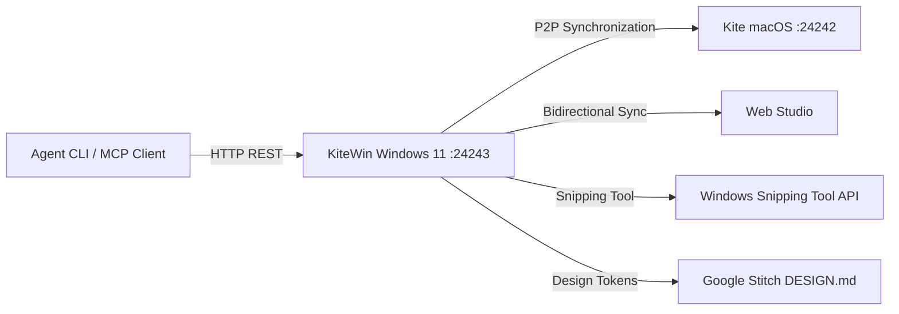

# KiteWin for Windows 11

**The Native Windows 11 Studio for Ideas, Architecture, and Antigravity Skills**

[](https://github.com/Tasonai/KiteWin/releases/tag/v1.3.0)
[](https://github.com/Tasonai/KiteWin/releases)
[](#craftsmanship-and-quality-gates)
[-success.svg)](#craftsmanship-and-quality-gates)
[](#craftsmanship-and-quality-gates)

---

## 1. Overview

KiteWin is a high-craft desktop application and idea banking system built natively for Windows 11 using WinUI 3, C# / .NET 10, and SQLite WAL persistence. It provides 100% feature and design parity with the macOS version (`Kite`) while honoring Windows 11 platform standards (Mica Alt materials, right-side caption buttons, Snap Layouts).



---

## 2. Key Capabilities

### 2.1. 3-Pillar Information Architecture
- **Pillar 1: Проекты и бэклог (Workspace)**
  - Все идеи, В разработке, Готово, Избранное.
- **Pillar 2: Архитектура и синтез (Engineering Core)**
  - Холст топологии, Промпт-переводчик, AI-Советник, База скиллов.
- **Pillar 3: Дизайн и интеграции (Ecosystem)**
  - Синхронизация P2P по локальной сети с macOS.

### 2.2. 4-Wave Engineering Hub (32+ Studios)
Integrated into the Prompt Translator via native WinUI 3 drop-down menus:
- **Wave 1: Схема и Данные**: Data Schema Designer (PostgreSQL/Prisma), Model Router (Gemini 3.8), Index Optimizer (zero-downtime DDL), Seed Data Generator, Vector Store Specifier (pgvector), Migration Strategist (Expand & Contract).
- **Wave 2: Сервисы и API**: API Contract Builder, Typed RPC (tRPC), EventBus Studio, Job Queue Strategist, Rate Limiter (Upstash Redis), Query Cache Studio, Realtime WebSockets, Webhook Simulator, Webhook Dispatcher.
- **Wave 3: UI и Токены**: Token Sandbox, StateFlow Simulator (XState), Sitemap Router Builder, Accessibility Auditor (WCAG 2.2 AAA), SEO Studio (Next.js Metadata), Interactive Mockup Generator.
- **Wave 4: QA и Релиз**: Antigravity Pack (4 Waves), Canvas Topology Validator, Terminal Error Doctor, Threat Modeler (OWASP STRIDE), Secret Shield, Eval Harness (Vitest), Conventional Commits & PR, Deploy Blueprints (Vercel/Docker), Incident Commander, Stress Test (k6), Developer Runbook.

### 2.3. Topology Canvas & Live Dataflow Simulation
- Infinite freeform canvas with node cards, stickies, and grouping frames.
- Cubic Bezier connection lines calculated from node centers with protocol badges (`tRPC`, `EventBus`, `SQL`).
- **Live 25 FPS Simulation Mode**: Animated throughput particle stream and real-time RPS/QPS metrics along connection curves.
- Export to **Google Stitch** (`DESIGN.md`), **Figma** (Tokens JSON), and **Mermaid** diagrams.

### 2.4. Apple HIG Monochrome Design System (Windows Isolated)
- Neutral monochrome dark (`#1C1C1E` / `#2C2C2E`) and light (`#F2F2F7` / `#FFFFFF`) theme dictionaries.
- Isolated from Windows wallpaper tint and OS accent colors for identical cross-platform aesthetics.
- Native right-hand caption buttons with Snap Layouts and adaptive contrast.
- Absolute zero emojis (100% Segoe Fluent Icons).

### 2.5. Model Context Protocol (MCP) & Agent CLI Bridge
- Fully compatible with `/usr/local/bin/kite` and `tools/kite-cli.py`.
- Exposes tools over stdio JSON-RPC for Claude Desktop, Cursor, and Antigravity.
- Programmatic idea management, canvas co-architecting, and project scaffolding.

---

## 3. Installation & Downloads

Pre-built zero-admin installers are available on the [Releases page](https://github.com/Tasonai/KiteWin/releases/tag/v1.3.0):

| Package | Format | Architecture | Download |
| :--- | :--- | :--- | :--- |
| **KiteWin GUI Setup** | `.exe` | Windows 11 x64 (Native PE32+) | [Download Setup.exe](https://github.com/Tasonai/KiteWin/releases/download/v1.3.0/KiteWin-1.3.0-Setup.exe) |
| **KiteWin Portable Archive** | `.zip` | Windows 11 x64 (Standalone) | [Download ZIP](https://github.com/Tasonai/KiteWin/releases/download/v1.3.0/KiteWin-1.3.0-win-x64.zip) |

---

## 4. Craftsmanship and Quality Gates

KiteWin enforces automated quality gates verified on every commit:

```bash
python3 tools/quality_gate.py
```

1. **Windows 11 BAWA 4 epx Grid Lint**: Verifies all margins, padding, spacing, and dimensions adhere to multiples of 4 epx.
2. **Zero Emojis Audit**: 100% Segoe Fluent Icons compliance across all files.
