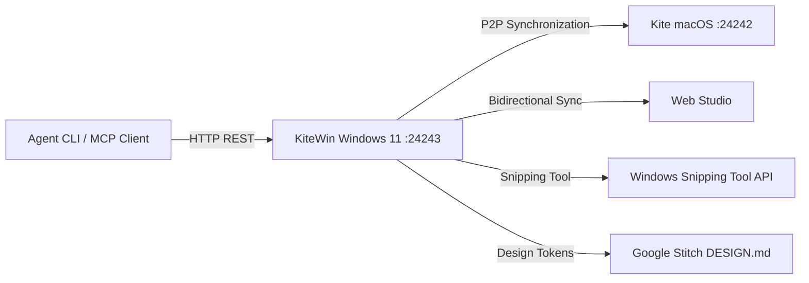

# KiteWin for Windows 11

**The Native Windows 11 Studio for Ideas, Architecture, and Antigravity Skills**

[](https://github.com/Tasonai/KiteWin/releases/tag/v1.0.0)
[](https://github.com/Tasonai/KiteWin/releases)
[](#craftsmanship-and-quality-gates)
[-success.svg)](#craftsmanship-and-quality-gates)
[](#craftsmanship-and-quality-gates)

---

## 1. Overview

KiteWin is a high-craft desktop application and idea banking system built natively for Windows 11 using WinUI 3, C# / .NET 10, and SQLite WAL persistence. It connects seamlessly to macOS (`Kite`) and the Web Studio via a peer-to-peer (P2P) local synchronization bridge.



---

## 2. Key Capabilities

### 2.1. Windows 11 Fluent Design & BAWA Standard
- **WinUI 3 & .NET 10**: Modern Windows App SDK architecture with Mica Alt backdrop material.
- **Strict 4 epx Layout Grid**: All spacing, padding, and corner radiuses strictly adhere to the 4 epx modular scale.
- **Tray Daemon Mode**: Seamless window lifecycle management. Closing the window minimizes KiteWin to the system notification tray.
- **Global Quick Capture HUD**: `Ctrl+Shift+K` (Win32 `RegisterHotKey` with subclassing) summons the floating capture panel instantly.

### 2.2. Antigravity Skills Catalog (355 Skills & 18 Plugins)
- Comprehensive catalog covering Frontend, Cloud, Mobile, Accessibility, and Architecture.
- All commands and prompt templates formatted with slash syntax:
  - `/site-md` — Project constitution and screen mapping
  - `/design-md` — Semantic design system tokens in Markdown
  - `/taste-design` — Typography curation and aesthetic hierarchy
  - `/emil-design-eng` — Tactile interactions and physical spring transitions
  - `/a11y-debugging` — WCAG AA accessibility compliance
  - `/gsd-execute-phase` — Wave-based execution with atomic commits

### 2.3. Infinite Visual Canvas & Design Tokens
- Freeform canvas supporting Pan & Zoom (`60%` - `160%`).
- Draggable Idea nodes, color-coded Sticky notes, and Reference cards.
- Export directly to **Google Stitch** (`DESIGN.md`) and **Figma** (W3C Design Tokens JSON).

### 2.4. Snipping Tool Integration
- Quick Capture HUD includes an integrated screen snip launcher (`ms-screenclip:`).
- Facilitates rapid visual reference collection into the idea bank and canvas.

---

## 3. Installation & Downloads

Pre-built zero-admin installers are available on the [Releases page](https://github.com/Tasonai/KiteWin/releases/tag/v1.0.0):

| Package | Format | Architecture | Download |
| :--- | :--- | :--- | :--- |
| **KiteWin GUI Setup** | `.exe` | Windows 11 x64 (Native PE32+) | [Download Setup.exe](https://github.com/Tasonai/KiteWin/releases/download/v1.0.0/KiteWin-1.0.0-Setup.exe) |
| **KiteWin Portable Archive** | `.zip` | Windows 11 x64 (Standalone) | [Download ZIP](https://github.com/Tasonai/KiteWin/releases/download/v1.0.0/KiteWin-1.0.0-win-x64.zip) |

### Installation Features
- **Zero Administrator Rights Required**: Installs directly into `%LOCALAPPDATA%\Programs\KiteWin`.
- **System Integration**: Automatically registers Start Menu and Desktop shortcuts with `AppIcon.ico`.
- **Clean Uninstaller**: Registered in the Windows Control Panel (`Settings > Apps > Installed apps`).

### SHA256 Checksums
```text
cfd9dad5f13b2c19b4da6c9923637c42e710a01b93c829d0b139fb3a410b6f07  KiteWin-1.0.0-Setup.exe
f533b31b14320fad4c3e2177f3db87952363e9f2e9fa499c23ebc67a3d031779  KiteWin-1.0.0-win-x64.zip
```

---

## 4. P2P Local Synchronization Protocol

KiteWin listens on TCP port `24243` using a built-in asynchronous `HttpListener`:

| Endpoint | Method | Description |
| :--- | :--- | :--- |
| `/api/status` | GET | Health check and capability probe |
| `/api/ideas` | GET / POST | Bidirectional idea replication and atomic merge |
| `/api/canvas` | GET / POST | Canvas layout and token graph synchronization |

Connect to macOS Kite (`127.0.0.1:24242`) with a single click from the **Синхронизация P2P** page.

---

## 5. Craftsmanship and Quality Gates

KiteWin adheres to the strict BAWA (Build Anything on Windows Architecture) craftsmanship specification:
- **Zero Emojis Policy**: Strictly 100% Segoe Fluent Icons and clean typography. Emojis are strictly prohibited.
- **4 epx Grid Lint**: All layout elements in XAML and C# are validated against the 4 epx modular scale.
- **Pre-Commit Verification**: Local Git pre-commit hook runs `tools/quality_gate.py` before any commit.

### Running Quality Gate Manually
```bash
python tools/quality_gate.py
```

---

## 6. Building from Source

### Prerequisites
- Windows 11 (build 22621 or newer)
- .NET 10 SDK or later
- Windows App SDK 1.6+

### Build and Package
```powershell
git clone https://github.com/Tasonai/KiteWin.git
cd KiteWin

# Build release binaries
.\build.ps1 -Configuration Release

# Package installer
.\tools\package.ps1
```

---

## 7. License

Licensed under the MIT License.
